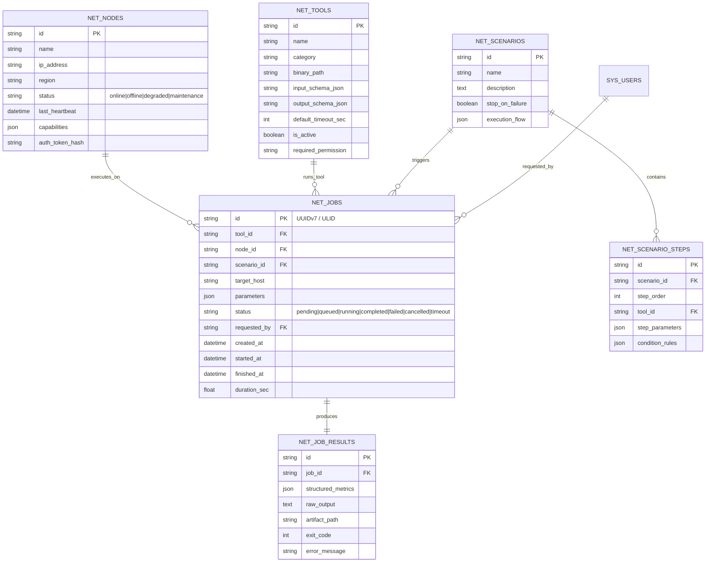
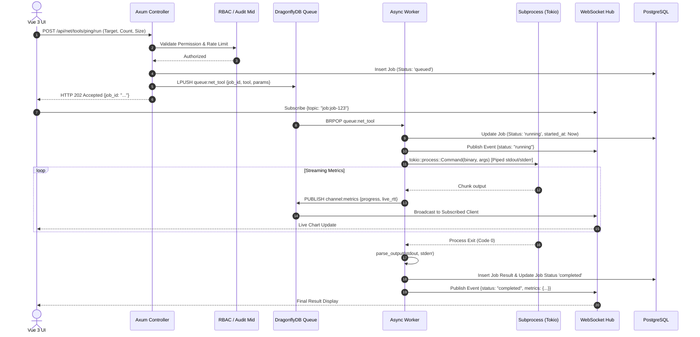

# Technical Design Document (TDD)
## Network Swiss Army & Speedtest Engine Architecture

---

## 1. System Architecture & High-Level Design

The Network Swiss Army & Speedtest platform is structured as a modular, decoupled architecture leveraging **QiLuo** (Rust + Axum + Sea-ORM), **DragonflyDB** (In-Memory Queue, State, Pub/Sub), and **Vue 3 + TypeScript** (Frontend Dashboard & Real-Time Telemetry).

```
                      +--------------------------------------------------+
                      |         Vue 3 / TypeScript Web & Desktop        |
                      |  (Dashboard, Tool Runner, Scenario DAG, Mon.)    |
                      +-------------------------+------------------------+
                                                |
                              REST API (JWT)    |  WebSocket Telemetry
                                                v
                      +--------------------------------------------------+
                      |              QiLuo Admin Backend (Axum)          |
                      |  - RBAC & Auth Middleware                        |
                      |  - Tool Registry & Validation                    |
                      |  - Job Dispatcher & Scheduler                    |
                      |  - WebSocket Session & Event Hub                 |
                      |  - Audit & Operation Logger                      |
                      +------------+------------------------+------------+
                                   |                        |
                       Persistent  |                        |  Pub/Sub &
                       Data (SQL)  |                        |  Job Queues
                                   v                        v
                      +------------+------------+  +--------+------------+
                      |   PostgreSQL / SQLite   |  |     DragonflyDB     |
                      |  - User & Role Tables   |  |  - Job Task Queue   |
                      |  - Tool Definitions     |  |  - Ephemeral State  |
                      |  - Jobs & Results       |  |  - Live Metric P/S  |
                      |  - Nodes & Scenarios    |  |  - Rate Limiter     |
                      +-------------------------+  +--------+------------+
                                                            |
                                                            | Fetch Job &
                                                            | Publish Progress
                                                            v
                      +--------------------------------------------------+
                      |           Async Network Worker Engine            |
                      |  +--------------------------------------------+  |
                      |  | Tool Executor (Safe Process API / Tokio)   |  |
                      |  | - ICMP Ping      - MTR        - Traceroute |  |
                      |  | - iPerf3 Engine  - UDP Echo   - TCPDump    |  |
                      |  | - TR-143 HTTP Download / Upload Diagnostic |  |
                      |  +--------------------------------------------+  |
                      |  | Stream Parser, Metric Extractor & DB Sync  |  |
                      +--------------------------------------------------+
```

---

## 2. Directory & Module Structure

The platform extends `qiluo_admin` cleanly without polluting base system files:

```text
qiluo_admin/
├── Cargo.toml
├── src/
│   ├── main.rs
│   ├── lib.rs
│   ├── app.rs                         <-- QiLuo Lifecycle & Worker Bootstrap
│   ├── api/                           <-- API Controllers
│   │   ├── sys_controll.rs
│   │   ├── net_tool_api.rs            <-- [NEW] Tool Execution & Parameter Endpoints
│   │   ├── net_job_api.rs             <-- [NEW] Job Management & History
│   │   ├── net_scenario_api.rs        <-- [NEW] Scenario CRUD & Run
│   │   ├── net_node_api.rs            <-- [NEW] Edge Node Management
│   │   └── net_ws_api.rs              <-- [NEW] WebSocket Connection & Subscription
│   ├── tools/                         <-- [NEW] Modular Tool Engine
│   │   ├── mod.rs                     <-- Tool Registry & Trait Definitions
│   │   ├── registry.rs                <-- Tool Metadata & Discovery
│   │   ├── ping.rs                    <-- Ping Argument Builder & Parser
│   │   ├── traceroute.rs              <-- Traceroute Parser
│   │   ├── mtr.rs                     <-- MTR JSON/Raw Parser
│   │   ├── iperf3.rs                  <-- iPerf3 Structured Output Processor
│   │   ├── tr143/                     <-- TR-143 Engine
│   │   │   ├── mod.rs
│   │   │   ├── download.rs            <-- Multi-connection HTTP Download Engine
│   │   │   ├── upload.rs              <-- HTTP Upload Generator
│   │   │   └── echo.rs                <-- RFC 862 / TR-143 UDP/TCP Echo
│   │   ├── udpecho.rs                 <-- High precision UDP Echo Tester
│   │   ├── tcpdump.rs                 <-- BPF Capturing & PCAP Manager
│   │   └── dns.rs                     <-- DNS & Port Diagnostic
│   ├── worker/                        <-- Async Background Execution
│   │   ├── net_tool_worker.rs         <-- [NEW] Network Task Processor Worker
│   │   ├── scenario_worker.rs         <-- [NEW] Multi-step Scenario DAG Worker
│   │   └── node_heartbeat_worker.rs   <-- [NEW] Distributed Node Monitor
│   ├── model/                         <-- Sea-ORM Entities & DTOs
│   │   ├── net_tool.rs                <-- Tool Registry Entity
│   │   ├── net_job.rs                 <-- Job Execution Entity
│   │   ├── net_job_result.rs          <-- Structured Diagnostic Results
│   │   ├── net_scenario.rs            <-- Scenario & Step Entities
│   │   └── net_node.rs                <-- Node Entity
│   └── service/                       <-- Business Logic Services
│       ├── s_net_tool.rs
│       ├── s_net_job.rs
│       ├── s_net_scenario.rs
│       └── s_net_node.rs
```

---

## 3. Database Schema & Sea-ORM Entities



### 3.1 SQL Table Definitions (PostgreSQL Dialect)

```sql
-- 1. Tools Definition Table
CREATE TABLE net_tools (
    id VARCHAR(64) PRIMARY KEY,
    name VARCHAR(128) NOT NULL,
    category VARCHAR(64) NOT NULL, -- connectivity, throughput, packet, dns, scenario
    binary_path VARCHAR(255) NOT NULL,
    input_schema_json JSONB NOT NULL,
    output_schema_json JSONB NOT NULL,
    default_timeout_sec INT DEFAULT 30,
    is_active BOOLEAN DEFAULT TRUE,
    required_permission VARCHAR(128) NOT NULL,
    created_at TIMESTAMP WITH TIME ZONE DEFAULT NOW()
);

-- 2. Nodes Table
CREATE TABLE net_nodes (
    id VARCHAR(64) PRIMARY KEY,
    name VARCHAR(128) NOT NULL,
    ip_address VARCHAR(64) NOT NULL,
    region VARCHAR(64) NOT NULL,
    status VARCHAR(32) DEFAULT 'online',
    last_heartbeat TIMESTAMP WITH TIME ZONE DEFAULT NOW(),
    capabilities JSONB,
    auth_token_hash VARCHAR(255),
    created_at TIMESTAMP WITH TIME ZONE DEFAULT NOW()
);

-- 3. Jobs Execution Table
CREATE TABLE net_jobs (
    id VARCHAR(64) PRIMARY KEY,
    tool_id VARCHAR(64) REFERENCES net_tools(id),
    node_id VARCHAR(64) REFERENCES net_nodes(id),
    scenario_id VARCHAR(64),
    target_host VARCHAR(255) NOT NULL,
    parameters JSONB NOT NULL,
    status VARCHAR(32) NOT NULL DEFAULT 'pending',
    requested_by VARCHAR(64) NOT NULL,
    created_at TIMESTAMP WITH TIME ZONE DEFAULT NOW(),
    started_at TIMESTAMP WITH TIME ZONE,
    finished_at TIMESTAMP WITH TIME ZONE,
    duration_sec DOUBLE PRECISION DEFAULT 0.0
);

CREATE INDEX idx_net_jobs_status ON net_jobs(status);
CREATE INDEX idx_net_jobs_target ON net_jobs(target_host);
CREATE INDEX idx_net_jobs_created ON net_jobs(created_at DESC);

-- 4. Job Results Table
CREATE TABLE net_job_results (
    id VARCHAR(64) PRIMARY KEY,
    job_id VARCHAR(64) UNIQUE REFERENCES net_jobs(id) ON DELETE CASCADE,
    structured_metrics JSONB,
    raw_output TEXT,
    artifact_path VARCHAR(512),
    exit_code INT,
    error_message TEXT,
    created_at TIMESTAMP WITH TIME ZONE DEFAULT NOW()
);

-- 5. Scenarios Table
CREATE TABLE net_scenarios (
    id VARCHAR(64) PRIMARY KEY,
    name VARCHAR(128) NOT NULL,
    description TEXT,
    stop_on_failure BOOLEAN DEFAULT TRUE,
    execution_flow JSONB NOT NULL,
    created_by VARCHAR(64) NOT NULL,
    created_at TIMESTAMP WITH TIME ZONE DEFAULT NOW()
);
```

---

## 4. Tool Engine Abstraction & Security Model

To ensure no arbitrary shell execution occurs, every tool implements the `NetworkTool` trait with strict argument validation.

```rust
use async_trait::async_trait;
use serde::{Deserialize, Serialize};
use std::process::Output;
use tokio::process::Command;
use crate::common::error::Result;

#[derive(Debug, Clone, Serialize, Deserialize)]
pub struct ToolContext {
    pub job_id: String,
    pub target: String,
    pub timeout_sec: u64,
    pub raw_params: serde_json::Value,
}

#[async_trait]
pub trait NetworkTool: Send + Sync {
    /// Unique tool identifier (e.g., "iperf3", "ping")
    fn id(&self) -> &'static str;
    
    /// Target binary path (e.g., "/usr/bin/iperf3")
    fn binary(&self) -> &'static str;
    
    /// Build strongly-typed arguments vector (Zero arbitrary shell injection)
    fn build_args(&self, ctx: &ToolContext) -> Result<Vec<String>>;
    
    /// Parse stdout/stderr into structured JSON metrics
    fn parse_output(&self, stdout: &str, stderr: &str) -> Result<serde_json::Value>;
    
    /// Maximum allowed execution duration in seconds
    fn max_timeout(&self) -> u64 { 300 }
}
```

### 4.1 Process Execution & Sandboxing Workflow



---

## 5. High-Throughput Speedtest Engine Specs

### 5.1 iPerf3 JSON Stream Processor
- **Execution**: Spawned with `-J` (JSON format) and `--logfile` or streaming pipe.
- **Client Argument Builder**:
  ```rust
  let mut args = vec![
      "-c".to_string(), ctx.target.clone(),
      "-p".to_string(), port.to_string(),
      "-t".to_string(), duration.to_string(),
      "-P".to_string(), streams.to_string(),
      "-J".to_string(),
  ];
  if protocol == "udp" {
      args.push("-u".to_string());
      args.push("-b".to_string());
      args.push(bandwidth_limit);
  }
  if is_reverse {
      args.push("-R".to_string());
  }
  ```

### 5.2 Native TR-143 Engine Architecture
TR-143 tests are built natively in Rust using Tokio and Hyper for maximum throughput without depending on external binaries:

1. **TR-143 Download Diagnostic**:
   - Spawns $N$ concurrent HTTP/1.1 or HTTP/2 client connections to the target diagnostic endpoint.
   - Measures exact byte count transfer rate with timestamping:
     $$\text{Throughput (bps)} = \frac{\text{TestBytesReceived} \times 8}{\text{EOMTime} - \text{BOMTime}}$$
   - Captures Request Time, Response Time, and Chunked throughput sampling every 200ms.

2. **TR-143 Upload Diagnostic**:
   - Generates chunked synthetic in-memory payloads (zeros/random) avoiding disk I/O bottleneck.
   - Streams POST requests with accurate buffer telemetry.

3. **TR-143 UDP Echo (RFC 862)**:
   - Client sends sequenced UDP packets containing millisecond timestamp and sequence ID.
   - Server reflects packets.
   - Client calculates: Jitter (RFC 3550 algorithm), One-Way Delay, Packet Loss, Out-of-Order count.

---

## 6. WebSocket Protocol Specification

### 6.1 Handshake & Authentication
Clients connect to `/api/net/ws?token=<JWT_TOKEN>`. The connection is validated via QiLuo's token validator.

### 6.2 Message Format (JSON)

#### Client $\rightarrow$ Server (Subscription Request)
```json
{
  "action": "subscribe",
  "topic": "job:01J8ABCDEF1234567890XYZ"
}
```

#### Server $\rightarrow$ Client (Live Telemetry Frame)
```json
{
  "event": "telemetry",
  "job_id": "01J8ABCDEF1234567890XYZ",
  "tool": "iperf3",
  "timestamp": 1755845000210,
  "data": {
    "current_speed_mbps": 948.5,
    "average_speed_mbps": 941.2,
    "retransmits": 0,
    "progress_percent": 65,
    "elapsed_seconds": 6.5
  }
}
```

#### Server $\rightarrow$ Client (Job Status Change)
```json
{
  "event": "status_changed",
  "job_id": "01J8ABCDEF1234567890XYZ",
  "status": "completed",
  "summary": {
    "avg_throughput_mbps": 942.8,
    "total_bytes": 1178500000,
    "duration_sec": 10.02
  }
}
```

---

## 7. REST API Endpoints

| Method | Path | Description | Required RBAC Permission |
| :--- | :--- | :--- | :--- |
| `GET` | `/api/net/tools` | List all available tools & schemas | `net:tool:list` |
| `POST` | `/api/net/tools/:tool_id/run` | Submit immediate single tool job | `net:tool:execute` |
| `GET` | `/api/net/jobs` | Query paginated job history | `net:job:query` |
| `GET` | `/api/net/jobs/:id` | Get job details and metrics | `net:job:query` |
| `POST` | `/api/net/jobs/:id/cancel` | Cancel active running job | `net:job:cancel` |
| `GET` | `/api/net/jobs/:id/pcap` | Download PCAP artifact | `net:tcpdump:download` |
| `GET` | `/api/net/scenarios` | List diagnostic scenarios | `net:scenario:list` |
| `POST` | `/api/net/scenarios` | Create / update scenario DAG | `net:scenario:manage` |
| `POST` | `/api/net/scenarios/:id/run` | Trigger scenario execution | `net:scenario:run` |
| `GET` | `/api/net/nodes` | Get registered edge nodes | `net:node:list` |
| `POST` | `/api/net/nodes/heartbeat` | Node agent heartbeat ping | `net:node:agent` |
